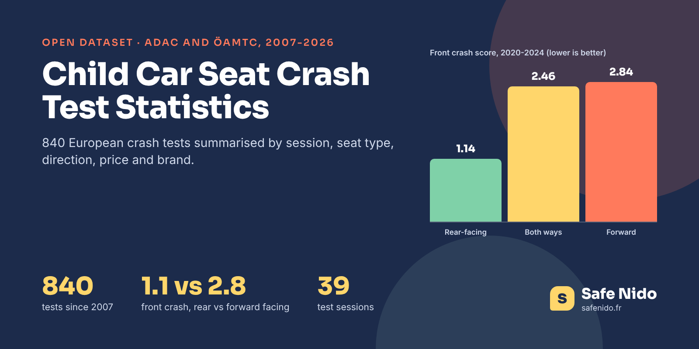

# Child Car Seat Crash Test Statistics 2007-2026



[](https://doi.org/10.5281/zenodo.24154292) [](https://www.kaggle.com/datasets/safenido/child-car-seat-crash-test-statistics-2007-2026) [](https://huggingface.co/datasets/safenido/child-car-seat-crash-test-statistics) [](https://creativecommons.org/licenses/by/4.0/) [](https://www.safenido.fr/)

**English first, version française plus bas.**

Twice a year, European motoring clubs led by the German ADAC crash, rate and take apart the child car seats on sale. Since 2007, **840 tests** have been published. This dataset summarises all of them in five tables, by test session, seat type, direction of travel, price band and brand, with the number of seats in each grade band, the share rated poor and the average crash scores.

It only contains statistics computed by Safe Nido. The individual results belong to ADAC and ÖAMTC and can be read on their websites or on the seat pages of [Safe Nido](https://www.safenido.fr/test-adac/).

### The Headline Numbers

|  |  |
|---|---|
| Crash tests, 2007 to October 2026 | 840 |
| Test sessions | 39 |
| Front crash score, rear-facing seats, 2020-2024 | 1.14 |
| Front crash score, forward-facing seats, 2020-2024 | 2.84 |
| Seats under 100 euros rated poor, 2011-2014 | 46% |
| Average overall grade, autumn 2024 session | 2.39 |
| Average overall grade, autumn 2026 session (2025 protocol) | 3.09 |

ADAC grades run from 0.5 (very good) to 5.5 (poor), so lower is better. The clearest result is about direction. Under the 2020-2024 protocol, rear-facing seats averaged **1.14 on the front crash**, against **2.84 for forward-facing seats**, and the front crash is the most common and most violent type of crash. Price says much less. Above 100 euros the average safety grade barely moves with price, while the cheapest seats are the ones that fail most often.

Grades from different protocol eras should not be compared. The 2025 protocol is stricter, which is why average grades rose in 2025 and 2026 without seats getting worse.

### Files

| file | content |
|---|---|
| `data/tests_by_session.csv` | 39 rows, one per test session (year and season) |
| `data/tests_by_seat_type_and_era.csv` | By seat type and protocol era |
| `data/tests_by_direction_and_era.csv` | Rear-facing, forward-facing or both, by era |
| `data/tests_by_price_band_and_era.csv` | By price at test and era |
| `data/tests_by_brand.csv` | Brands with at least 5 tests |
| `images/cover.png` | Cover image, 1600 × 800 |

### Columns

**every table**

| column | description |
|---|---|
| `tests` | Number of tests in the group |
| `mean_overall_grade, median_overall_grade` | Overall ADAC grade, 0.5 very good to 5.5 poor |
| `n_very_good ... n_poor` | Tests in each grade band (up to 1.5, 2.5, 3.5, 4.5, above 4.5) |
| `share_good_or_better, share_poor` | Percentages |
| `n_poor_on_safety, n_poor_on_pollutants` | Tests graded poor on the safety part or on harmful substances |
| `mean_safety_grade, mean_handling_grade, mean_ergonomics_grade, mean_pollutants_grade` | Average part grades |
| `mean_front_crash_score, mean_side_crash_score` | Average front and side impact scores, 1 best to 5 worst |
| `median_price_eur` | Median price at the time of the test |
| `era` | Protocol era, 2007-2010, 2011-2014, 2015-2019, 2020-2024, 2025+ |

### Load It

```python
import pandas as pd

base = "https://raw.githubusercontent.com/safenido/child-car-seat-crash-test-statistics/main"
df = pd.read_csv(f"{base}/data/tests_by_direction_and_era.csv")
df.pivot(index="era", columns="direction", values="mean_front_crash_score")
```

### How It Was Built

Built from the Safe Nido database, which records the published results of every ADAC test since 2007 and of 22 ÖAMTC tests, with the seat type, direction and price at the time of the test. Tests were grouped and summarised with Python. Seat types follow Safe Nido's own classification.

### Checked Against The Source

Session sizes were checked against the ADAC announcements (16 seats in October 2026, 26 in May 2026) and the failing seats of recent sessions were checked one by one.

### Read With Care

- **Protocols change.** ADAC reworked its test in 2011, 2015, 2020 and 2025. Compare within an era.
- **Prices are prices at the time of the test**, in euros of that year.
- **A poor overall grade can come from harmful substances** rather than crash results. Use n_poor_on_safety and n_poor_on_pollutants.
- **No individual results are published here.** They belong to ADAC and ÖAMTC.

### License And Citation

**[CC BY 4.0](https://creativecommons.org/licenses/by/4.0/)**. Use it, share it and adapt it, commercially or not, and credit **Safe Nido** with a link to **[safenido.fr](https://www.safenido.fr/)**, along with the original source below.

```bibtex
@misc{safenido_child_car_seat_crash_test_statistics_2026,
  title  = {Child Car Seat Crash Test Statistics 2007-2026},
  author = {{Safe Nido}},
  year   = {2026},
  doi    = {10.5281/zenodo.24154292},
  url    = {https://github.com/safenido/child-car-seat-crash-test-statistics},
  note   = {Dataset, version 1.0}
}
```

Source. Published results of the ADAC and ÖAMTC child seat tests 2007-2026, aggregated by Safe Nido, https://www.safenido.fr/test-adac/

Archived on **[Zenodo](https://doi.org/10.5281/zenodo.24154292)** with a permanent DOI, 10.5281/zenodo.24154292.

Companion datasets, **[Child Car Seat Specifications Europe](https://github.com/safenido/child-car-seat-specs)** ([Kaggle](https://www.kaggle.com/datasets/safenido/child-car-seat-specifications-europe), [Hugging Face](https://huggingface.co/datasets/safenido/child-car-seat-specs)), **[Child Car Seat Recalls Europe 2016-2026](https://github.com/safenido/child-car-seat-recalls-europe)** ([Kaggle](https://www.kaggle.com/datasets/safenido/child-car-seat-recalls-europe-2016-2026), [Hugging Face](https://huggingface.co/datasets/safenido/child-car-seat-recalls-europe)). All Safe Nido datasets are listed in **[Child Passenger Safety Datasets](https://github.com/safenido/child-passenger-safety-datasets)**.

Also on **[GitHub](https://github.com/safenido/child-car-seat-crash-test-statistics)**, **[Kaggle](https://www.kaggle.com/datasets/safenido/child-car-seat-crash-test-statistics-2007-2026)** with a starter notebook, and **[Hugging Face](https://huggingface.co/datasets/safenido/child-car-seat-crash-test-statistics)**, ready for the `datasets` library.

### On Safe Nido

The data behind these files is used on [Safe Nido](https://www.safenido.fr/), an independent French guide to child car seats built on twenty years of crash tests.

- [Every ADAC result, explained](https://www.safenido.fr/test-adac/)
- [How to read an ADAC grade](https://www.safenido.fr/test-adac/comment-lire-note-adac/)
- [Autumn 2026 ADAC session](https://www.safenido.fr/test-adac/automne-2026/)
- [Seats to avoid](https://www.safenido.fr/sieges-auto-a-eviter/)

---

## Version Française

### Les Crash-Tests De Sièges Auto En Statistiques, 2007-2026

840 tests ADAC et ÖAMTC résumés par session, type de siège, sens de montage, prix et marque.

- Sur le protocole 2020-2024, les sièges dos à la route obtiennent 1,14 au choc frontal contre 2,84 pour les sièges face à la route (plus la note est basse, mieux c'est).
- Les sièges à moins de 100 euros sont ceux qui échouent le plus souvent.
- Seules les statistiques calculées par Safe Nido sont publiées ici, pas les notes individuelles.

Licence CC BY 4.0, en citant **Safe Nido** et un lien vers **[safenido.fr](https://www.safenido.fr/)**. Retrouvez les guides et les fiches des sièges sur [Safe Nido](https://www.safenido.fr/).
